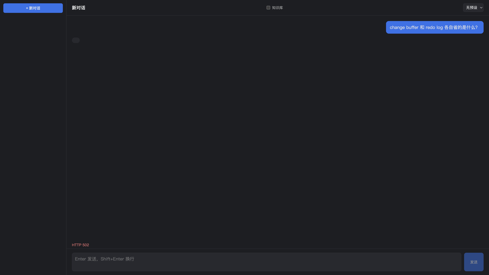
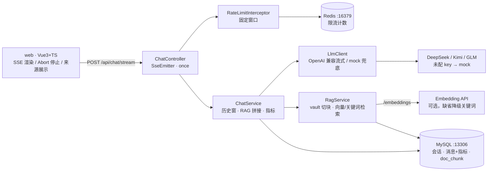

# agent-lab

> 远程仓：https://github.com/sunhuoxyr/agent-lab（private）

个人全栈练习场：**Vue 3 + Spring Boot (Java) + MySQL + Redis + 大模型**。
双目的：上手大模型（流式对话 / RAG），同时把四样技术串成一条真实链路。



## 栈与落点

| 层 | 技术 | 练什么 |
| --- | --- | --- |
| 前端 | Vue 3 + TS + Vite（pnpm） | SSE 流式渲染（fetch + ReadableStream，POST 不能用 EventSource） |
| 后端 | Spring Boot 3 / Java 17+ | Controller→Service→Mapper 分层；SseEmitter；WebClient 调 LLM |
| 持久化 | MySQL 8 | MyBatis 为主（会话/消息）；JPA 对照模块（提示词预设） |
| 缓存 | Redis 7 | 聊天接口限流（INCR + EXPIRE 固定窗口） |
| LLM | OpenAI 兼容接口 | 国内三家直连；未配 key 自动 mock，骨架可离线跑通 |

## 结构



```
server/   Spring Boot 后端（Maven）
  chat/         SSE 聊天 + LlmClient（OpenAI 兼容流式 / mock 兜底）
  conversation/ 会话与消息（MyBatis）+ /api/stats 指标
  rag/          RAG：切块 · embedding · 检索 · reindex
  preset/       提示词预设（Spring Data JPA，对照模块）
  ratelimit/    Redis 限流拦截器
  common/       Web 配置 + 统一异常
web/      Vue 前端（Vite）
docker-compose.yml  MySQL(13306) + Redis(16379)（避开工作本机常用端口）
```

## 启动

```bash
docker compose up -d                      # MySQL + Redis
cd server && JAVA_HOME=/usr/local/opt/openjdk@21 \
  mvn -s settings-central.xml org.springframework.boot:spring-boot-maven-plugin:3.3.5:run
# 后端 :8080（建表走 schema.sql，幂等）
# settings-central.xml 直连 Maven Central：公司 Nexus 会卡插件前缀扫描、批量 jar 下载断流
cd web && pnpm install && pnpm dev        # 前端 :5173（/api 代理到 8080）
```

> 容器均配 `restart: unless-stopped`，随 Docker 自起；后端是手动 `mvn` 进程，Mac 重启后要重跑第二行。

## LLM 配置（环境变量）

不配 `LLM_API_KEY` 时自动进入 **mock 模式**（回显输入），骨架可先跑通。

| 厂商 | LLM_BASE_URL | 模型示例 |
| --- | --- | --- |
| DeepSeek（默认） | `https://api.deepseek.com` | `deepseek-chat` |
| Kimi | `https://api.moonshot.cn` | `kimi-k2` 系列 |
| GLM | `https://open.bigmodel.cn/api/paas/v4` | `glm-4` 系列 |

```bash
export LLM_API_KEY=sk-xxx
# 可选：export LLM_BASE_URL=... LLM_MODEL=...
```

## MyBatis vs JPA 对照（本仓落点）

- MyBatis：`conversation/` 注解式 SQL，显式、贴近工作栈
- JPA：`preset/` 约定 CRUD，零 SQL；同库混用，共用一个 DataSource

## backlog

会话标题自动生成（问 LLM）· 消息重生成 · 用户认证 · 限流改滑动窗口 · 向量库替换（Milvus/Chroma，量大了再说）

已勾（2026-10-16）：RAG（切块检索 + 中文 bigram 降级）· Abort 停止 + 半截落库（stopped 态，CAS 防双写）· token/TTFT 指标 + /api/stats · n8n 每晚 22:30 自动 reindex（flow-lab 侧）
